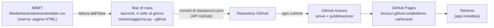

# Tabellone Carburanti — documentazione tecnica

Versione 1.2.0 · Biagio Raucci · licenza MIT

Questo documento descrive l'architettura, le fonti e le regole di lettura dei
dati (con le ragioni di ogni scelta), il tabellone a palette, l'installazione
passo passo e la manutenzione.

---

## 1. Architettura

Il lavoro è diviso fra tre attori, ciascuno con un solo compito:



- **Il Mac legge.** Un *LaunchAgent* (il pianificatore di macOS) esegue il
  motore più volte al giorno. Il motore scarica le medie ufficiali e, se ci
  sono dati nuovi, sostituisce `data/prezzi.json` nel repository con un commit.
- **GitHub pubblica.** Ogni commit sul ramo `main` fa partire il workflow, che
  esegue le prove, controlla gli invarianti dei dati e rimette online il sito.
- **Il telefono mostra.** La pagina legge `data/prezzi.json` dalla sua stessa
  origine e anima le palette; funziona anche offline con l'ultimo dato.

Nel codice la stessa separazione si ritrova fra solutore e post-processore:

- **`motore/core.py`**: solo funzioni pure (ricevono testo, restituiscono
  strutture dati), verificabili in isolamento;
- **`motore/aggiorna.py`**: l'I/O, cioè rete con rispetto di `robots.txt`,
  file locali, riepilogo nel registro;
- **`motore/deposito.py`**: lettura e scrittura del file nel repository
  tramite l'API *contents* di GitHub;
- **`index.html`**: nessuna elaborazione, solo la visualizzazione.

### 1.1 Perché la lettura avviene dal Mac

La prima versione leggeva i dati da GitHub Actions. Il 19/10/2026 la diagnosi
ha dato questo quadro:

| Verifica | Esito | Conclusione |
|---|---|---|
| `robots.txt` del Ministero | `User-agent: *` con divieti solo per le cartelle di sistema di Joomla e per le pagine di ricerca | la pagina delle medie e il CSV **sono consentiti** |
| Richiesta dal Mac (`curl`) | `200` | dall'Italia il sito risponde |
| Richiesta dai server di GitHub | nessuna risposta entro il tempo limite | il sito non risponde a quei server |

I server di GitHub stanno in centri di calcolo all'estero; molti siti della
pubblica amministrazione scartano in silenzio quel traffico. La lettura deve
quindi partire da una connessione italiana. Le regole del sito restano
rispettate: il motore legge `robots.txt` prima di ogni richiesta.

### 1.2 Perché il telefono non legge direttamente il sito

Il browser applica la politica della stessa origine (CORS): una pagina
pubblicata su `braucci.github.io` non può leggere il contenuto di
`www.mimit.gov.it`, che non lo autorizza. In più il Ministero riceve poche
richieste al giorno, non una per ogni apertura dell'app.

---

## 2. Le fonti e la lettura dei dati

### 2.1 Fonte principale: il CSV ufficiale

Sotto la tabella della pagina *Prezzi medi dei carburanti – Autostrade* c'è il
link «Media prezzi alle 8 (csv)», che porta a
`https://www.mimit.gov.it/images/stories/carburanti/MediaNazionaleAutostradale.csv`.
Il contenuto del 19/10/2026:

```
Aggiornamento 19-10-2026
TIPO;TIPOLOGIA;EROGAZIONE;PREZZO MEDIO
AUTOSTRADALE;Gasolio;SELF;2.297
AUTOSTRADALE;Benzina;SELF;2.048
AUTOSTRADALE;GPL;SERVITO;0.901
AUTOSTRADALE;Metano;SERVITO;1.900
```

È la fonte migliore per tre ragioni: è un file pensato per essere scaricato,
ha una struttura stabile e **dichiara la data della rilevazione**. Il lettore:

- trova la riga *Aggiornamento* e ne estrae la data (formato `gg-mm-aaaa`);
- individua le colonne **per nome** e non per posizione, deducendo il
  separatore dall'intestazione;
- accetta solo le righe con `TIPO = AUTOSTRADALE`, se la colonna c'è.

Il tabellone riporta **esattamente** queste quattro righe: nessun calcolo,
nessuna stima. Secondo la nota informativa della pagina, le medie sono
aritmetiche e calcolate sui prezzi in vigore alle 8:00 del giorno; per gasolio
e benzina sui prezzi self service, per GPL e metano su quelli del servito.

### 2.2 Fonte di riserva: la pagina HTML

Se il CSV non è leggibile, il motore legge la tabella
`TIPOLOGIA | EROGAZIONE | PREZZO MEDIO` della pagina. Il parser non dipende
dal markup: esamina tutte le righe di tabella e, se non ne trova, ripiega su
un'espressione regolare sul testo. La pagina però non riporta la data: in quel
caso si assume la data odierna (prezzi delle 8:00 *del medesimo giorno*) e lo
si annota con `data_dedotta: true`.

### 2.3 Regole comuni di accettazione

Una riga, dal CSV o dalla pagina, è accettata solo se soddisfa
**contemporaneamente** tre condizioni:

1. **Tipologia** esattamente uguale a *Gasolio*, *Benzina*, *GPL* o *Metano*:
   restano fuori GNL, L-GNC e i carburanti speciali.
2. **Erogazione** riconoscibile: *SELF*, *Self service*, *self-service*
   diventano `SELF`; *SERVITO* diventa `SERVITO`. L'erogazione mostrata è
   quella letta, non una presupposta.
3. **Prezzo** plausibile, fra 0,3 e 5 €.

A parità di carburante vale la prima riga. I prezzi sono letti come `Decimal`
dalla forma testuale, così 2.297 resta 2,297 e non 2,29699999…

**Unità di misura.** Prezzo al litro per gasolio, benzina e GPL, al
chilogrammo per il metano (metadati dell'Osservatorio). Il tabellone scrive
`€/L`: il simbolo maiuscolo è ammesso dal Sistema Internazionale e nel
carattere condensato non si confonde con una I.

### 2.4 Fonte non ancora aggiornata

Il motore gira più volte al giorno, anche prima che il Ministero pubblichi.
Con il CSV non c'è ambiguità: se riporta ancora la data di ieri, i valori di
ieri vengono reintegrati identici e non si scrive nulla.

Con la pagina HTML, che non ha data, vale questa regola: *se tutte e quattro
le medie coincidono al millesimo con quelle dell'ultimo giorno registrato, il
nuovo giorno non viene scritto*. Siano $q_i$ le probabilità che la media del
carburante $i$ resti invariata al millesimo da un giorno all'altro; trattando
gli eventi come indipendenti, la probabilità che restino tutte ferme è

$$
P = \prod_{i=1}^{4} q_i ,
$$

e anche con la stima generosa $q_i = 0{,}3$ si ha $P \approx 0{,}008$. Nel
raro caso di errore i prezzi mostrati restano corretti; è sbagliata solo la
data, che risulta quella del giorno prima.

### 2.5 Variazioni

La colonna *Var.* riporta la differenza, in millesimi di euro, rispetto alla
rilevazione precedente **dello stesso carburante con la stessa erogazione**.
Le differenze sono calcolate in decimale (in virgola mobile 2,297 − 2,298 vale
−0,000999999…) e prima di ogni scrittura si controlla l'invariante
`prezzo − variazione = prezzo precedente`.

### 2.6 Scrittura nel repository

`motore/deposito.py` usa due chiamate dell'API REST di GitHub:

1. `GET /repos/braucci/tabellone-carburanti/contents/data/prezzi.json`
   restituisce il file e il suo **sha**, l'impronta della versione letta;
2. `PUT` sullo stesso indirizzo invia il nuovo contenuto insieme a quello sha.

Se nel frattempo il file è cambiato, GitHub rifiuta la scrittura (409) invece
di sovrascrivere: il motore rilegge, ricalcola e riprova una volta. Se i dati
non cambiano non si scrive nulla, quindi nasce al massimo un commit al giorno.

Il token è *fine-grained*, limitato a questo solo repository e al solo
permesso **Contents: Read and write**. Sul Mac è conservato nel Portachiavi
alla voce `tabellone-carburanti`; in alternativa il motore lo legge dalla
variabile d'ambiente `TABELLONE_TOKEN`.

---

## 3. Il tabellone a palette

### 3.1 Il tamburo

Ogni cella imita un modulo dei tabelloni elettromeccanici (i Solari delle
stazioni italiane): un tamburo di $N = 44$ palette che gira **in un solo verso**

```
␣ A B C … Z 0 1 2 … 9 , . : / + - =
0 1 2 3   26 27 28 29  36 37 …    43
```

Per passare dal carattere di indice $i$ a quello di indice $j$ servono

$$
k = (j - i) \bmod N \quad\text{passi},\qquad t = k\,\tau ,
$$

con $\tau = 62$ ms per passo, circa 16 palette al secondo, valore scelto a
occhio dello stesso ordine di grandezza dei tabelloni reali. È un motore passo
passo: la posizione angolare del tamburo è $\theta = k \cdot 2\pi/N$.

| Carattere | Indice $j$ | Passi dalla paletta vuota | Tempo |
|---|---|---|---|
| G | 7 | 7 | 0,43 s |
| S | 19 | 19 | 1,18 s |
| 0 | 27 | 27 | 1,67 s |
| 9 | 36 | 36 | 2,23 s |

Le cifre stanno dopo le lettere nel tamburo: i nomi dei carburanti si fermano
per primi e **il prezzo si compone per ultimo**, senza ritardi artificiali.
L'intero tabellone si assesta in circa 3,5 s. Il pulsante *Rigira le palette*
aggiunge un giro completo a ogni cella.

L'animazione è guidata dal tempo, non dai fotogrammi: un solo ciclo
`requestAnimationFrame` calcola per ogni cella il passo in corso,
$\lfloor (t - t_0)/\tau \rfloor$, e la fase dentro il passo, con lo stesso
risultato a 60 e a 120 Hz.

### 3.2 Il singolo passo

Ogni cella è fatta di quattro metà, due fisse e due mobili (le "ante"). Nella
prima metà del passo l'anta alta, con il carattere vecchio, ruota da $0°$ a
$-90°$ con moto accelerato; nella seconda l'anta bassa, con il carattere
nuovo, ruota da $90°$ a $0°$ con un leggero rimbalzo. Per una lamina rigida
incernierata a un lato, di lunghezza $L$, il momento d'inerzia del
second'ordine rispetto alla cerniera è $I = mL^2/3$ e il momento della forza
peso è $mg\,(L/2)\sin\theta$, quindi

$$
\ddot\theta = \frac{3g}{2L}\sin\theta ,
$$

accelerazione nulla all'avvio e massima in orizzontale: la legge quadratica
dell'animazione ne approssima la forma.

### 3.3 La targa e l'accessibilità

- In fondo alla cassa una targhetta in alluminio spazzolato porta il nome
  **Biagio Raucci**, come la targa *Solari Udine* dei tabelloni veri; lo stesso
  nome chiude la riga LED.
- Con *riduci movimento* attivo, le palette si posizionano senza animazione e
  la riga LED non scorre.
- Ogni riga ha un'etichetta per i lettori di schermo.
- Il suono delle palette si attiva con il pulsante *Suono*.
- Se la scheda torna in primo piano dopo più di 30 minuti, i dati vengono
  ricaricati e girano solo le celle cambiate.

---

## 4. Struttura del repository

```
tabellone-carburanti/
├── index.html                   tabellone: pagina, stile, animazione
├── sw.js                        service worker: offline e cache
├── manifest.webmanifest         installazione come app
├── icone/                       icone dell'app
├── data/prezzi.json             dati pubblicati (li scrive il Mac)
├── motore/
│   ├── core.py                  lettura di CSV e pagina, storico, invarianti
│   ├── aggiorna.py              I/O: rete, robots.txt, file, registro
│   ├── deposito.py              lettura e scrittura nel repository GitHub
│   ├── test_core.py             32 prove automatiche
│   └── campioni/                CSV reale del 19/10/2026 e pagina di prova
├── strumenti/
│   ├── macos/installa.sh        installa l'aggiornamento automatico sul Mac
│   ├── macos/disinstalla.sh     lo rimuove
│   └── genera_icone.py          rigenera le icone (serve Pillow)
├── .github/workflows/aggiorna.yml   prove e pubblicazione su GitHub Pages
├── verifica.sh                  prove locali e server di anteprima
├── docs/tabellone.png           immagine per il README
├── pyproject.toml  CHANGELOG.md  LICENSE  .gitignore
└── README.md  README-progetto.md
```

### 4.1 Il file `data/prezzi.json` (schema 2)

| Campo | Significato |
|---|---|
| `schema` | versione del formato (2) |
| `generato_il` | istante della lettura, ora di Roma |
| `fonte` | indirizzo, formato (`csv` o `html`), esito, data letta, `data_dedotta` |
| `rilevazione` | data più recente presente sul tabellone |
| `tabellone` | quattro righe: `carburante`, `erogazione`, `prezzo`, `unita`, `data`, `variazione`, `data_precedente` |
| `storico` | per ogni giorno e carburante, `erogazione` e `prezzo` come pubblicati; 400 giorni |

---

## 5. Messa in funzione, passo passo

### 5.1 Aggiornare il workflow su GitHub

Il file `.github/workflows/aggiorna.yml` non si può caricare trascinandolo
(GitHub rifiuta i file nascosti): si modifica nel browser.

1. Nel repository apri `.github` → `workflows` → `aggiorna.yml`.
2. Premi l'icona a matita (*Edit this file*).
3. Seleziona tutto il testo, cancellalo e incolla il nuovo contenuto.
4. *Commit changes…* → *Commit changes*.

### 5.2 Caricare il resto dei file

Trascina nel repository, con *Add file → Upload files*, la cartella `motore`,
la cartella `strumenti` e i file `index.html`, `sw.js`, `pyproject.toml`,
`CHANGELOG.md`, `README.md`, `README-progetto.md`.

**Non caricare mai la cartella `data`**: il file dei prezzi lo scrive il Mac, e
ricaricarlo cancellerebbe lo storico.

### 5.3 Creare il token GitHub

1. Su GitHub: foto del profilo in alto a destra → **Settings** →
   **Developer settings** (in fondo alla colonna di sinistra) →
   **Personal access tokens** → **Fine-grained tokens** →
   **Generate new token**.
2. *Token name*: `Tabellone Carburanti (Mac)`. *Expiration*: un anno.
3. *Repository access*: **Only select repositories** →
   `braucci/tabellone-carburanti`.
4. *Permissions* → *Repository permissions*: **Contents** →
   **Read and write**. (*Metadata: Read-only* si aggiunge da solo.)
5. **Generate token** e copia il token, che inizia con `github_pat_`.
   GitHub lo mostra **una sola volta**: tienilo negli appunti per il passo
   successivo.

### 5.4 Installare l'aggiornamento automatico sul Mac

1. Scarica e decomprimi lo zip del progetto (doppio clic nella cartella
   Download).
2. Apri il **Terminale** e scrivi:

   ```bash
   cd ~/Downloads/tabellone-carburanti
   bash strumenti/macos/installa.sh
   ```

   Se macOS chiede se il Terminale può accedere alla cartella Download,
   rispondi *OK*.
3. Lo script esegue sei controlli e si ferma con una spiegazione se uno non
   passa:
   1. trova un Python 3.10 o successivo;
   2. verifica che Python apra connessioni HTTPS (con il Python di python.org
      a volte mancano i certificati: lo script indica il comando che li
      installa);
   3. copia il motore in `~/Library/Application Support/TabelloneCarburanti`
      ed esegue le prove. Si usa quella cartella perché macOS non lascia
      leggere Scrivania, Documenti e Download ai programmi che partono da soli;
   4. chiede il token e lo salva nel **Portachiavi**: incollalo, premi Invio,
      incollalo di nuovo e premi Invio. Mentre lo incolli non compare nulla:
      è normale. Poi verifica che il token legga il repository;
   5. installa il LaunchAgent: ogni giorno alle 9:40, 11:40, 15:10 e 19:10, e
      a ogni accesso al Mac;
   6. esegue subito una prima lettura e ne mostra il registro.

Se a un'ora prevista il Mac dorme, launchd esegue il lavoro al risveglio; se è
spento, se ne occupa l'esecuzione all'accesso successivo.

### 5.5 Controllare che funzioni

- **Sul Mac**, il registro:

  ```bash
  tail -n 30 ~/Library/Logs/TabelloneCarburanti.log
  ```

  oppure l'app *Console*, alla voce *Log report*. Per un'esecuzione manuale:

  ```bash
  launchctl kickstart -k gui/$(id -u)/it.raucci.tabellone-carburanti
  ```

- **Su GitHub**: nella scheda *Code* compare un commit «Prezzi del gg/mm/aaaa»
  e nella scheda *Actions* un'esecuzione verde di «Pubblica tabellone».
- **Sul telefono**: <https://braucci.github.io/tabellone-carburanti/>.
  Android (Chrome): menu ⋮ → *Installa app*; iPhone (Safari): Condividi →
  *Aggiungi alla schermata Home*.

### 5.6 Se qualcosa non va

| Messaggio nel registro del Mac | Causa e rimedio |
|---|---|
| `token non valido o scaduto` | Genera un nuovo token (5.3) e rilancia `bash strumenti/macos/installa.sh --nuovo-token`. |
| `il token non ha il permesso necessario` | Nel token manca *Contents: Read and write*. |
| `repository non trovato` | Il token non è abilitato al repository: *Only select repositories* (5.3, punto 3). |
| `CSV MIMIT: errore …` e poi `pagina MIMIT letto` | Il CSV non era leggibile, è stata usata la pagina: nessuna azione. |
| `Nessuna fonte disponibile` | Il Mac non raggiunge il sito del Ministero: controlla la connessione. |
| `fonte probabilmente non ancora aggiornata` | Normale al mattino presto: ci pensa l'esecuzione successiva. |

| Sintomo su GitHub | Causa e rimedio |
|---|---|
| *Prova il motore* rossa | Il codice caricato non supera le prove: rimanda il registro dell'esecuzione. |
| *Controlla i dati da pubblicare* rossa | `data/prezzi.json` non rispetta gli invarianti: il sito resta alla versione precedente. |
| *Pubblica*: `Pages site not found` | *Settings → Pages → Source: GitHub Actions*. |

---

## 6. Prova in locale

Dalla cartella del progetto, su Linux o sul Mac:

```bash
./verifica.sh            # 32 prove, lettura del CSV di prova, controllo dei dati
./verifica.sh --servi    # e poi anteprima su http://<ip-del-computer>:8000
```

Per vedere l'anteprima sul telefono, collegalo alla stessa rete Wi-Fi. Su Arch
con un firewall attivo apri la porta (`sudo ufw allow 8000/tcp` oppure
`sudo firewall-cmd --add-port=8000/tcp`). Su indirizzi `http://` diversi da
`localhost` il browser non attiva il service worker: l'anteprima funziona,
senza modalità offline.

Il motore si può anche eseguire a mano, su un file locale:

```bash
python3 -m motore.aggiorna --json data/prezzi.json
```

---

## 7. Che cosa è verificato e che cosa no

**Verificato prima della consegna**

- Il formato reale del CSV ministeriale del 19/10/2026: il file è tra i
  campioni delle prove.
- Le regole di `robots.txt` del sito e la raggiungibilità dal Mac (`curl`:
  `200`); la mancata risposta ai server di GitHub, dal registro del workflow.
- 32 prove automatiche: lettura del CSV reale, colonne per nome, righe non
  autostradali escluse, data assente o futura, date con i trattini; pagina
  HTML con e senza data, script e carburanti speciali esclusi, ripiego
  testuale; passaggio dal CSV alla pagina se il CSV non è leggibile; storico,
  variazioni, fonte non aggiornata, invarianti; robots.txt secondo la RFC 9309
  e diagnostica nel registro; scrittura su GitHub simulata (prima scrittura,
  nessun commit a dati invariati, conflitto con rilettura, token rifiutato,
  verifica in sola lettura); coerenza della versione nei quattro file.
- Il motore copiato da solo in una cartella, come fa l'installatore, supera le
  prove.
- La sintassi degli script e il file `.plist` generato.

**Non verificato**

- L'installatore e il LaunchAgent su un Mac reale: li ho scritti per il bash
  3.2 di macOS e ne ho controllato la sintassi, ma non li ho potuti eseguire.
- Le chiamate all'API di GitHub con un token reale: sono provate contro una
  simulazione fedele dell'API *contents*. La prima esecuzione sul Mac è la
  prova definitiva, e il registro la racconta passo per passo.

---

## 8. Manutenzione

### Aggiornare il motore sul Mac

Il Mac usa la copia del motore in `~/Library/Application Support`. Dopo ogni
nuova versione, rilancia `bash strumenti/macos/installa.sh` dalla cartella del
progetto: ricopia il motore e riattiva la pianificazione, mentre il token resta
nel Portachiavi.

### Nuova versione

Il numero di versione compare in quattro file, e la prova
`test_versione_unica` fallisce se non coincidono:

1. `pyproject.toml` → `version = "1.3.0"`
2. `motore/__init__.py` → `__version__ = "1.3.0"`
3. `index.html` → `const VERSIONE = '1.3.0';`
4. `sw.js` → `const VERSIONE = '1.3.0';` (rinnova la cache sui telefoni)

Poi una voce in `CHANGELOG.md`, `./verifica.sh`, caricamento su GitHub e
reinstallazione sul Mac.

### Rimuovere l'aggiornamento automatico

```bash
bash strumenti/macos/disinstalla.sh
```

Lo script ferma il LaunchAgent, cancella la copia del motore e chiede se
cancellare anche il token dal Portachiavi. Se il token non serve più,
revocalo anche su GitHub (*Fine-grained tokens* → *Delete*).

### Icone

```bash
python3 -m pip install pillow         # su Arch: sudo pacman -S python-pillow
python3 strumenti/genera_icone.py ~/Downloads/BarlowCondensed-SemiBold.ttf
```

### Licenze

- Codice: MIT © 2026 Biagio Raucci.
- Dati: Ministero delle Imprese e del Made in Italy, Osservatorio prezzi
  carburanti (attribuzione nel piè di pagina e nella riga LED).
- Caratteri: Barlow, Barlow Condensed, DotGothic16 — SIL Open Font License,
  serviti da Google Fonts.
