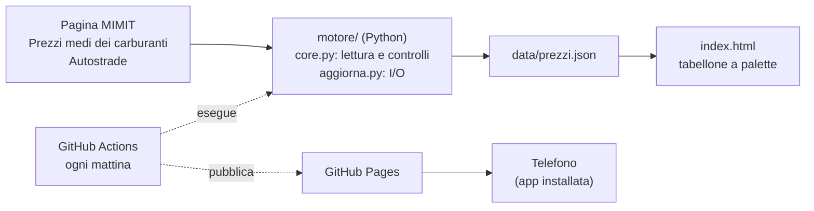

# Tabellone Carburanti — documentazione tecnica

Versione 1.1.1 · Biagio Raucci · licenza MIT

Questo documento descrive l'architettura, la lettura dei dati ministeriali
(con le ragioni di ogni scelta), il funzionamento del tabellone a palette, la
pubblicazione su GitHub passo passo e la manutenzione.

---

## 1. Architettura

Il progetto separa nettamente la **lettura dei dati** dalla
**visualizzazione**, come in una catena CFD si separano solutore e
post-processore:



- **`motore/core.py`** contiene solo funzioni pure: ricevono testo, restituiscono
  strutture dati. Nessun accesso alla rete o al disco, quindi ogni funzione è
  verificabile in isolamento con dati noti.
- **`motore/aggiorna.py`** fa tutto l'I/O: scarica la pagina (rispettando
  `robots.txt`), chiama il core, controlla gli invarianti, scrive il JSON in
  modo atomico.
- **`index.html`** non elabora nulla: legge `data/prezzi.json` e anima i valori.
- **GitHub Actions** è un computer che GitHub presta gratuitamente per qualche
  minuto, secondo un orario: esegue il motore, salva i dati nel repository e
  pubblica il sito su **GitHub Pages**. Non c'è alcun server da mantenere.

### Perché non leggere il sito MIMIT direttamente dal telefono

Il browser applica la politica della stessa origine (CORS): una pagina
pubblicata su `braucci.github.io` non può leggere il contenuto di
`www.mimit.gov.it`, che non lo autorizza. Il dato va quindi prelevato da un
programma fuori dal browser (il motore, su GitHub Actions) e servito dalla
stessa origine della pagina. Un vantaggio collaterale: il Ministero riceve due
richieste al giorno, non una per ogni apertura dell'app.

---

## 2. La fonte e la lettura dei dati

### 2.1 Che cosa pubblica il Ministero

La pagina *Prezzi medi dei carburanti – Autostrade* espone la tabella
*Media prezzi nazionale – Rete autostradale*:

| TIPOLOGIA | EROGAZIONE | PREZZO MEDIO |
|---|---|---|
| Gasolio | SELF | 2.297 |
| Benzina | SELF | 2.048 |
| GPL | SERVITO | 0.901 |
| Metano | SERVITO | 1.900 |

*(valori del 19/10/2026)*

Secondo la nota informativa della pagina, le medie sono aritmetiche, calcolate
sui prezzi in vigore alle 8:00 del giorno stesso; per gasolio e benzina si
usano i prezzi self service, per GPL e metano quelli del servito. Il tabellone
riporta **esattamente** queste quattro righe: nessun calcolo, nessuna stima.

**Unità di misura.** I metadati dell'Osservatorio indicano il prezzo al litro
in tutti i casi tranne il metano, venduto al chilogrammo: il tabellone scrive
`€/L` per gasolio, benzina e GPL e `€/kg` per il metano. Per il litro si usa
il simbolo maiuscolo L, ammesso dal Sistema Internazionale accanto alla l
minuscola, perché nel carattere condensato del tabellone la l minuscola si
confonde con una I.

### 2.2 Regole di lettura

Il parser non dipende dal markup della pagina: esamina tutte le righe di
tabella e accetta quelle che soddisfano **contemporaneamente** tre condizioni.

1. **Tipologia** esattamente uguale a *Gasolio*, *Benzina*, *GPL* o *Metano*
   (maiuscole indifferenti). Restano fuori GNL, L-GNC e i carburanti speciali:
   una riga *Benzina speciale* non viene confusa con la benzina.
2. **Erogazione** riconoscibile: *SELF*, *Self service*, *self-service*
   diventano `SELF`; *SERVITO* diventa `SERVITO`. L'erogazione mostrata sul
   tabellone è quella letta, non una presupposta: se domani il Ministero
   pubblicasse il gasolio servito, il tabellone lo direbbe.
3. **Prezzo** plausibile, fra 0,3 e 5 €: scarta errori di lettura come un
   numero d'anno o un valore con una cifra di troppo.

Se un carburante compare in più righe vale la prima, nell'ordine della pagina.
Se la pagina non contiene tabelle, si ripiega su un'espressione regolare sul
testo. I prezzi sono letti come `Decimal` dalla loro forma testuale, così 2.297
resta 2,297 e non 2,29699999…

**La data.** Si cerca nel testo la data più recente compresa fra dieci giorni
fa e oggi (sono quindi ignorate le date di decreti o di aggiornamenti della
pagina). Se la pagina non ne riporta, si assume la data odierna, coerente con
la nota informativa (prezzi delle 8:00 *del medesimo giorno*), e lo si annota
nel JSON con `data_dedotta: true`.

### 2.3 Pagina non ancora aggiornata

Se il workflow legge la pagina prima che il Ministero l'abbia aggiornata e la
pagina non riporta una data, si rischierebbe di registrare i valori di ieri
con la data di oggi. Il motore lo riconosce con questa regola: *se la data è
dedotta e tutte e quattro le medie coincidono al millesimo con quelle
dell'ultimo giorno registrato, il nuovo giorno non viene scritto*.

Giustificazione. Siano $q_i$ le probabilità che la media del carburante $i$,
calcolata su centinaia di impianti, resti invariata al millesimo da un giorno
all'altro. Trattando i quattro eventi come indipendenti, la probabilità che
restino tutte ferme è

$$
P = \prod_{i=1}^{4} q_i .
$$

Anche con una stima generosa $q_i = 0{,}3$ si ottiene $P = 0{,}3^4 \approx
0{,}008$: meno di un caso su cento. E l'errore residuo è innocuo: in quel caso
raro il tabellone mostra prezzi comunque corretti (identici), solo con la data
del giorno prima. La seconda esecuzione delle 13:47 recupera il caso di una
pubblicazione in ritardo.

### 2.4 Variazioni

La colonna *Var.* riporta la differenza, in millesimi di euro, rispetto alla
rilevazione precedente **dello stesso carburante con la stessa erogazione**:
un eventuale passaggio da self a servito non è una variazione di prezzo. Le
differenze sono calcolate in decimale (in virgola mobile 2,297 − 2,298 vale
−0,000999999…) e prima di ogni scrittura si controlla l'invariante
`prezzo − variazione = prezzo precedente`. La colonna si riempie dalla seconda
rilevazione in poi.

---

## 3. Il tabellone a palette

### 3.1 Il tamburo

Ogni cella imita un modulo dei tabelloni elettromeccanici (i Solari delle
stazioni italiane): un tamburo di $N = 44$ palette che gira **in un solo verso**

```
␣ A B C … Z 0 1 2 … 9 , . : / + - =
0 1 2 3   26 27 28 29  36 37 …    43
```

Per passare dal carattere di indice $i$ a quello di indice $j$ servono

$$
k = (j - i) \bmod N \quad\text{passi},\qquad t = k\,\tau ,
$$

con $\tau = 62$ ms per passo, circa 16 palette al secondo, valore scelto a
occhio dello stesso ordine di grandezza dei tabelloni reali. È un motore passo
passo: la posizione angolare del tamburo è $\theta = k \cdot 2\pi/N$.

Esempi, partendo dalla paletta vuota (indice 0):

| Carattere | Indice $j$ | Passi | Tempo |
|---|---|---|---|
| G | 7 | 7 | 0,43 s |
| S | 19 | 19 | 1,18 s |
| 0 | 27 | 27 | 1,67 s |
| 9 | 36 | 36 | 2,23 s |

Le cifre stanno dopo le lettere nel tamburo: per questo i nomi dei carburanti
si fermano per primi e **il prezzo si compone per ultimo**, senza bisogno di
ritardi artificiali. Ai passi si sommano piccoli ritardi d'avvio, per riga e
per colonna, con una componente casuale, così le celle non scattano tutte
insieme: l'intero tabellone si assesta in circa 3,5 s. Il pulsante *Rigira le
palette* aggiunge un giro completo ($N$ passi in più) a ogni cella.

L'animazione è guidata dal tempo, non dai fotogrammi: un solo ciclo
`requestAnimationFrame` calcola per ogni cella il passo in corso,
$\lfloor (t - t_0)/\tau \rfloor$, e la fase dentro il passo. Il risultato è
identico su schermi a 60 e a 120 Hz.

### 3.2 Il singolo passo

Ogni cella è fatta di quattro metà: due fisse e due mobili (le "ante").

1. Nella prima metà del passo l'anta alta, con il carattere vecchio, ruota da
   $0°$ a $-90°$ attorno alla cerniera, scoprendo la metà alta del carattere
   nuovo. Il moto è accelerato (angolo proporzionale al quadrato del tempo),
   come una lamina che cade per gravità.
2. Nella seconda metà l'anta bassa, con il carattere nuovo, ruota da $90°$ a
   $0°$ e copre la metà bassa vecchia, con un leggero rimbalzo finale.

Per una lamina rigida incernierata a un lato, di lunghezza $L$, il momento
d'inerzia del second'ordine rispetto alla cerniera è $I = mL^2/3$ e il momento
della forza peso è $mg\,(L/2)\sin\theta$, quindi

$$
\ddot\theta = \frac{3g}{2L}\sin\theta ,
$$

accelerazione angolare nulla all'avvio e massima in orizzontale: è la forma
che la legge quadratica approssima.

### 3.3 La targa

In fondo alla cassa una targhetta in alluminio spazzolato con due viti porta
il nome **Biagio Raucci**, come la targa *Solari Udine* fissata sui tabelloni
veri. Lo stesso nome chiude il messaggio della riga LED.

### 3.4 Accessibilità e risparmio

- Con *riduci movimento* attivo nel sistema, le palette si posizionano senza
  animazione e la riga LED non scorre.
- Ogni riga ha un'etichetta per i lettori di schermo («gasolio, self: 2,297
  euro al litro, rilevazione del 19/10/2026»).
- Il suono delle palette è spento all'avvio (i browser lo consentono solo dopo
  un tocco) e si attiva con il pulsante *Suono*.
- Se la scheda torna in primo piano dopo più di 30 minuti, i dati vengono
  ricaricati e girano solo le celle cambiate.

---

## 4. Struttura del repository

```
tabellone-carburanti/
├── index.html                 tabellone: pagina, stile, animazione
├── sw.js                      service worker: offline e cache
├── manifest.webmanifest       installazione come app
├── icone/                     icone dell'app (192, 512, maskable, iOS)
├── data/prezzi.json           dati pubblicati, scritti dal motore
├── motore/
│   ├── __init__.py            numero di versione
│   ├── core.py                lettura della pagina, storico, invarianti
│   ├── aggiorna.py            I/O: rete, robots.txt, scrittura atomica
│   ├── test_core.py           21 prove automatiche
│   └── campioni/              pagina di prova modellata su quella reale
├── strumenti/genera_icone.py  rigenera le icone (serve Pillow)
├── .github/workflows/aggiorna.yml
├── verifica.sh                prove locali e server di anteprima
├── docs/tabellone.png         immagine per il README
├── pyproject.toml  CHANGELOG.md  LICENSE  .gitignore
└── README.md  README-progetto.md
```

### 4.1 Il file `data/prezzi.json` (schema 2)

| Campo | Significato |
|---|---|
| `schema` | versione del formato (2) |
| `generato_il` | istante della lettura, ora di Roma |
| `fonte` | indirizzo, esito (`ok`, `pagina invariata rispetto al …`), data letta, `data_dedotta` |
| `rilevazione` | data più recente presente sul tabellone |
| `tabellone` | quattro righe nell'ordine della pagina: `carburante`, `erogazione`, `prezzo`, `unita`, `data`, `variazione`, `data_precedente` |
| `storico` | per ogni giorno e carburante, `erogazione` e `prezzo` come pubblicati; 400 giorni |

Il file iniziale contiene i valori pubblicati dal Ministero il 19/10/2026; le
variazioni compaiono dalla prima esecuzione automatica del giorno dopo.

---

## 5. Pubblicazione su GitHub, passo passo

Si usa solo il browser. Servono un account GitHub (`braucci`) e la cartella
del progetto decompressa sul computer.

### 5.1 Creare il repository

1. Su <https://github.com/new>: nome **`tabellone-carburanti`**, visibilità
   **Public** (GitHub Pages gratuito richiede un repository pubblico), nessun
   README, nessuna licenza, nessun `.gitignore` (li abbiamo già).
2. *Create repository*.

### 5.2 Caricare i file

1. Nella pagina del repository vuoto: *uploading an existing file*.
2. Trascina nella finestra **tutti i file e le cartelle** del progetto.
3. *Commit changes*.

> **Attenzione alle cartelle nascoste.** `.github` e `.gitignore` iniziano
> con un punto: GNOME Files (Nautilus) non le mostra finché non premi
> **Ctrl+H**, e alcuni browser le saltano nel trascinamento. Dopo il caricamento
> controlla che nel repository compaiano `.gitignore` e
> `.github/workflows/aggiorna.yml`. Se mancano:
>
> - *Add file → Create new file*;
> - come nome scrivi `.github/workflows/aggiorna.yml` (le barre creano le
>   cartelle);
> - incolla il contenuto del file dal computer e *Commit changes*.
>
> Stesso procedimento per `.gitignore`.

### 5.3 Attivare GitHub Pages

*Settings → Pages → Build and deployment → Source:* **GitHub Actions**.

### 5.4 Permessi del workflow

*Settings → Actions → General → Workflow permissions:* **Read and write
permissions** → *Save*. Serve perché il workflow salva i nuovi prezzi nel
repository.

### 5.5 Prima esecuzione

1. Scheda **Actions** → *Aggiorna tabellone* → **Run workflow** → *Run workflow*.
2. Dopo un paio di minuti apri l'esecuzione e il passaggio *Acquisisci i prezzi
   dal MIMIT*. Il riepilogo atteso ha questa forma:

   ```
   Tabellone Carburanti 1.1.0 — 20/10/2026 10:47
    • pagina MIMIT letta: 20/10/2026 (data non indicata: si assume oggi)
        GASOLIO  SELF     2.xxx €/l
        BENZINA  SELF     2.xxx €/l
        GPL      SERVITO  0.xxx €/l
        METANO   SERVITO  1.xxx €/kg
   Scritto data/prezzi.json
   ```

3. L'indirizzo del sito compare nel passaggio *Pubblica su GitHub Pages*:
   `https://braucci.github.io/tabellone-carburanti/`.

Da quel momento il workflow parte da solo alle 8:47 e alle 11:47 UTC, e a ogni
caricamento di file sul ramo `main`.

### 5.6 Installare sul telefono

- **Android (Chrome):** apri l'indirizzo → menu ⋮ → *Installa app*.
- **iPhone (Safari):** apri l'indirizzo → Condividi → *Aggiungi alla schermata
  Home*.

L'app si apre a schermo intero, come un'app nativa, e funziona offline con
l'ultimo dato scaricato (la riga LED lo segnala).

### 5.7 Se qualcosa non va

| Sintomo nel log | Causa e rimedio |
|---|---|
| *Archivia i dati*: `403` su `git push` | Permessi del workflow: punto 5.4. |
| *Pubblica*: `Pages site not found` o errore d'ambiente | Pages non attivo: punto 5.3. |
| `pagina MIMIT: saltata: robots.txt …` | Il sito vieta la lettura automatica di quella pagina; il motore lo rispetta e il tabellone mostra l'ultimo dato archiviato. |
| `nessuna riga riconosciuta` | È cambiata la struttura della pagina: va adeguata `leggi_pagina_ufficiale` in `core.py`. |
| `errore: HTTPError 403` | Il sito rifiuta le richieste dai server di GitHub; il tabellone continua a mostrare l'ultimo dato. |
| `pagina probabilmente non ancora aggiornata` | Normale alle 10:47 se il Ministero pubblica tardi: ci pensa l'esecuzione delle 13:47. |
| Il workflow non parte più da solo | GitHub sospende le esecuzioni pianificate dei repository pubblici senza attività per 60 giorni: *Actions → Aggiorna tabellone → Enable workflow*. Gli aggiornamenti quotidiani dei dati normalmente lo evitano. |

Le esecuzioni pianificate di GitHub possono partire con qualche minuto di
ritardo nelle ore di traffico: è normale.

---

## 6. Prova in locale (Arch Linux)

Python è già presente su Arch (`python --version`, almeno 3.10). Dalla cartella
del progetto:

```bash
./verifica.sh
```

esegue le 21 prove, una lettura completa della pagina di prova e il controllo
di manifest e dati. Per vedere il tabellone sul telefono senza pubblicarlo:

```bash
./verifica.sh --servi
```

e apri dal telefono, collegato alla stessa rete Wi-Fi, l'indirizzo stampato
(`http://192.168.x.y:8000`). Se il PC ha un firewall attivo, apri la porta:

```bash
sudo ufw allow 8000/tcp                                   # se usi ufw
sudo firewall-cmd --add-port=8000/tcp                     # se usi firewalld
```

Su indirizzi `http://` diversi da `localhost` il browser non attiva il service
worker (richiede HTTPS): l'anteprima funziona, solo senza modalità offline.

Per eseguire il motore vero, con la rete:

```bash
python3 -m motore.aggiorna --json data/prezzi.json
```

---

## 7. Che cosa è verificato e che cosa no

**Verificato prima della consegna**

- La struttura della tabella e i valori del 19/10/2026, dallo screenshot della
  pagina ministeriale: la pagina di prova in `motore/campioni` la riproduce.
- 21 prove automatiche: lettura dei quattro carburanti con l'erogazione
  pubblicata, ordine della pagina, data assente o presente, esclusione di
  script, carburanti speciali e prezzi implausibili, ripiego testuale,
  idempotenza dello storico, variazioni solo a parità di erogazione,
  riconoscimento della pagina non aggiornata, invarianti, regole RFC 9309 di
  `robots.txt`, tre esecuzioni consecutive del motore, coerenza del numero di
  versione nei quattro file.
- Resa grafica a 320, 390 e 430 pixel di larghezza con i caratteri definitivi:
  nessuno scorrimento orizzontale, nessun carattere tagliato nelle palette,
  nessun errore in console; funzionamento offline con il service worker.

**Non verificato**

- Il sorgente HTML reale della pagina (è stata vista la pagina resa dal
  browser, non il codice): il parser non dipende dal markup, ma la prima
  esecuzione su GitHub Actions è la prova definitiva.
- Se la pagina riporta da qualche parte la data della rilevazione: in caso
  contrario vale la regola del paragrafo 2.2.
- Le regole di `robots.txt` del sito ministeriale per questo programma,
  l'esecuzione del workflow su GitHub e l'installazione sui telefoni.

---

## 8. Manutenzione

### Nuova versione

Il numero di versione compare in quattro file, e la prova
`test_versione_unica` fallisce se non coincidono:

1. `pyproject.toml` → `version = "1.2.0"`
2. `motore/__init__.py` → `__version__ = "1.2.0"`
3. `index.html` → `const VERSIONE = '1.2.0';`
4. `sw.js` → `const VERSIONE = '1.2.0';` (cambiarlo rinnova la cache sui
   telefoni, che così scaricano la pagina nuova)

Poi una voce in `CHANGELOG.md`, `./verifica.sh`, e caricamento su GitHub.

### Icone

```bash
sudo pacman -S python-pillow
python3 strumenti/genera_icone.py ~/Scaricati/BarlowCondensed-SemiBold.ttf
```

### Licenze

- Codice: MIT © 2026 Biagio Raucci.
- Dati: Ministero delle Imprese e del Made in Italy, Osservatorio prezzi
  carburanti (attribuzione nel piè di pagina e nella riga LED).
- Caratteri: Barlow, Barlow Condensed, DotGothic16 — SIL Open Font License,
  serviti da Google Fonts.
