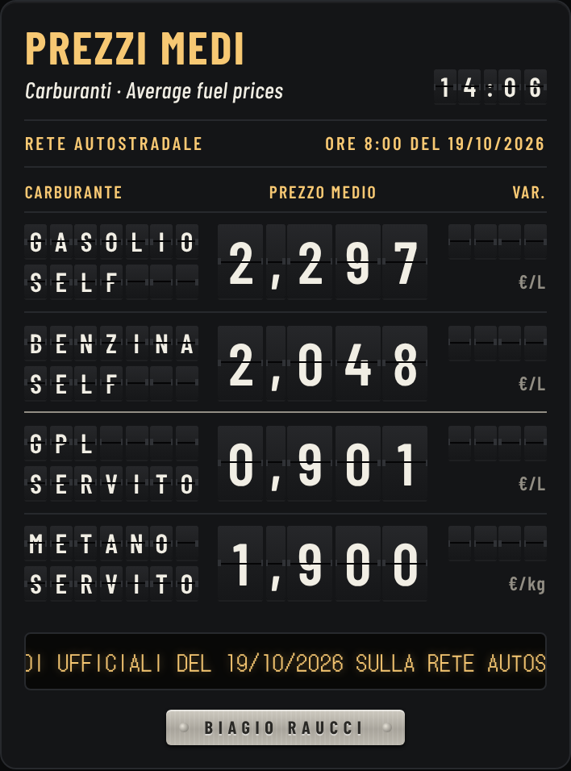

# Tabellone Carburanti

I prezzi medi ufficiali di **gasolio**, **benzina**, **GPL** e **metano** sulla
rete autostradale italiana, mostrati come su un tabellone ferroviario a
palette: all'apertura le palette girano e compongono i prezzi del giorno.

<p align="center"></p>

- **Valori come pubblicati dal Ministero**, con l'erogazione indicata dalla
  pagina (self per gasolio e benzina, servito per GPL e metano): nessun calcolo,
  nessuna stima.
- **App web installabile** sul telefono (Android e iPhone), funziona anche offline.
- **Aggiornamento automatico ogni mattina** con GitHub Actions, senza server da
  mantenere.

**Apri il tabellone:** <https://braucci.github.io/tabellone-carburanti/>

## Installazione sul telefono

- **Android (Chrome):** apri il link, menu ⋮ → *Installa app* (o *Aggiungi a schermata Home*).
- **iPhone (Safari):** apri il link, pulsante Condividi → *Aggiungi alla schermata Home*.

## Prova in locale

```bash
./verifica.sh            # prove automatiche, senza rete
./verifica.sh --servi    # e poi anteprima su http://<ip-del-pc>:8000
```

Serve solo Python 3.10 o successivo, senza librerie aggiuntive.

## Documentazione

Architettura, regole di lettura dei dati con le relative giustificazioni,
pubblicazione passo passo su GitHub e manutenzione:
**[README-progetto.md](README-progetto.md)**.

## Fonti e licenze

- Dati: Osservatorio prezzi carburanti, Ministero delle Imprese e del Made in
  Italy — [Prezzi medi dei carburanti – Autostrade](https://www.mimit.gov.it/it/prezzo-medio-carburanti/autostrade).
- Caratteri: Barlow, Barlow Condensed, DotGothic16 (SIL Open Font License).
- Codice: licenza MIT © 2026 Biagio Raucci.
